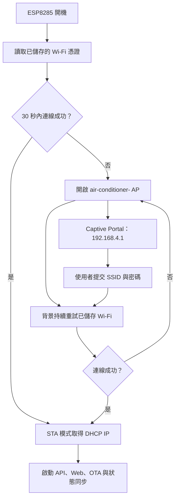
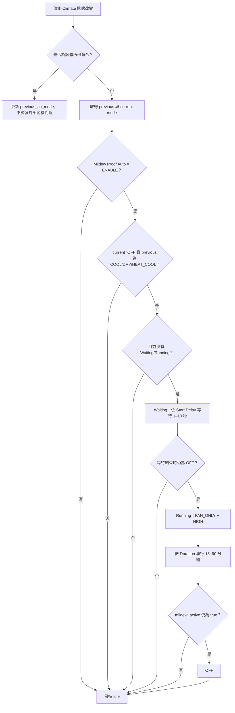
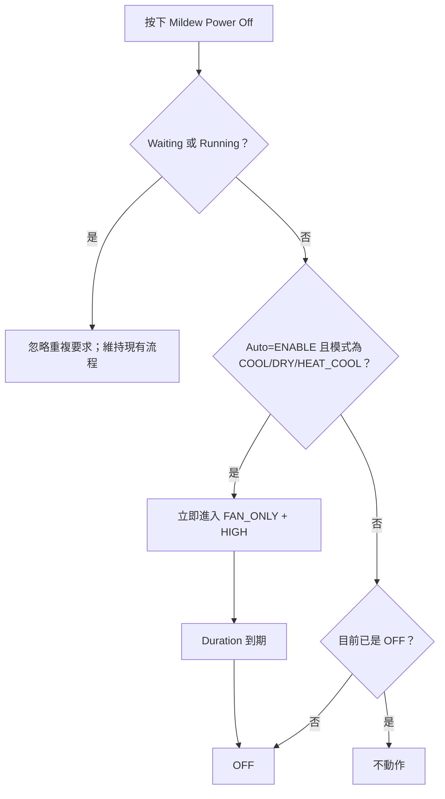
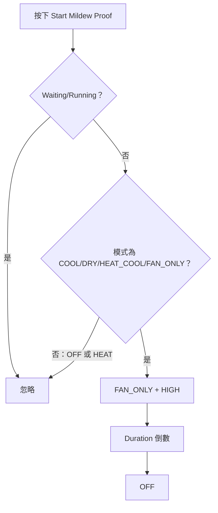
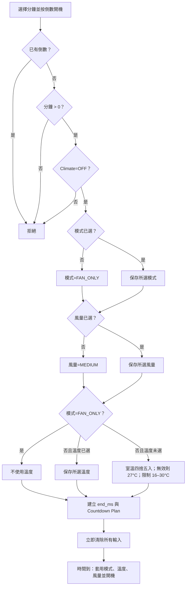
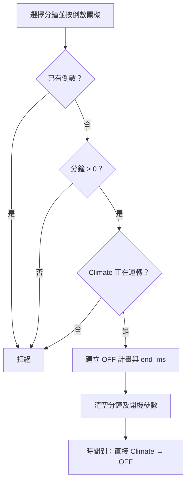

# 冷氣控制器 FINAL 1.1.0 完整技術移轉、使用者體驗與雲端規範

## 文件版本

**Unified Resource First Edition V2.2 — 完整基準版**

本文件不是 FINAL 1.0.0 的差異清單，也不是只有 Firebase 的增補說明。它完整定義：

- FINAL 1.0.0 所有既有冷氣控制、倒數、防霉、診斷、Wi-Fi、API、OTA 與本機網頁功能。
- FINAL 1.1.0 的使用者導向介面重整。
- Firebase Authentication 使用者帳號、首次配對、移轉擁有者及忘記密碼流程。
- Firebase Realtime Database REST Streaming／SSE 遠端狀態與命令。
- ESP8285 的 Flash、RAM、TLS、CPU、Wi-Fi 與網頁負載限制。

任何來源碼、CSS、JavaScript、使用者手冊、發布映像或 Firebase 設定與本文件不一致時，都不得宣稱完成封裝。

## 1. 規格目的

本文件定義可由其他工程師或 AI 在另一台電腦上重建同一成品所需的全部終端規格。內容以發布包內的 YAML、CSS 與 JavaScript 為唯一實作基準，不依賴任何歷史版本。

## 2. 交付物

```text
AirConditioner-FINAL-1.1.0/
├─ README.md
├─ Source/
│  ├─ air-conditioner-final.yaml
│  ├─ air-conditioner-final.css
│  ├─ air-conditioner-final.js
│  └─ air-conditioner-final-preview.html
├─ Release/
│  ├─ air-conditioner-final-ota.bin
│  ├─ air-conditioner-final-factory.bin
│  └─ SHA256SUMS.txt
└─ Documentation/
   ├─ 01-USER-MANUAL.md
   ├─ 02-DESIGN-TRANSFER-SPEC.md
   └─ 03-DT-06-CLOUD-RESOURCE-FIRST-SPEC.md
```

三個來源檔必須位於同一資料夾。YAML 的 `css_include` 與 `js_include` 使用同層相對路徑。

`air-conditioner-final-preview.html` 提供模擬資料及假的 EventSource／fetch，供設計人員在瀏覽器預覽版面；它不參與韌體編譯，也不能控制真實冷氣。

## 3. 工具鏈與重建環境

| 項目 | 規格 |
|---|---|
| 韌體框架 | ESPHome |
| 驗證與發布工具版本 | ESPHome 2026.7.2 |
| 目標平台 | ESP8266 |
| 目標板型 | ESP8285 |
| Framework | Arduino ESP8266 3.1.2 |
| PlatformIO 平台 | `platformio/espressif8266@4.2.1` |
| Flash | 2 MB |
| Linker script | `eagle.flash.2m1m.ld` |
| 編譯介面 | ESPHome Device Builder、ESPHome CLI 或等效容器 |
| 原始碼編碼 | UTF-8 |

CLI 指令：

```powershell
esphome config air-conditioner-final.yaml
esphome compile air-conditioner-final.yaml
```

編譯前不得改變三個來源檔的相對位置。

Windows 的 PlatformIO 相依套件包含深層目錄。若發布包所在路徑很長，應把三個編譯來源暫時複製到短路徑，例如：

```text
C:\Temp\acf\
```

完成後再將產出的 BIN 複製回 `Release/`。此工作目錄只用於建置，不得成為來源檔的另一個維護分支。

## 4. 硬體與通訊

| 介面 | 設定 |
|---|---|
| UART RX | GPIO3 |
| UART TX | GPIO1 |
| Baud rate | 9600 |
| Climate 平台 | `midea` |
| 查詢週期 | 1000 ms |
| 單次回覆逾時 | 3 s |
| 嘗試次數 | 3 |
| 自動偵測 | `autoconf: true` |
| 蜂鳴器命令 | 啟用 |
| 板載狀態 LED | GPIO4，硬體上拉至 3.3 V，輸出反相 |
| SW1 | GPIO0，配合 Reset 進入 UART 燒錄模式 |
| SW2 | RST，硬體重啟 |

控制器每秒查詢冷氣。單次通訊等待最多 3 秒，最多嘗試三次。UART logger 的 serial 輸出關閉，避免 GPIO1/GPIO3 與冷氣通訊衝突；日誌仍可經 API 與網頁讀取。

SW1 與 SW2 不是一般冷氣功能鍵。GPIO0 是 ESP8266 開機模式腳位，RST 是硬體重置腳位；韌體不得將兩者包裝成一般使用者按鈕。首次有線燒錄時依序按住 SW1、按一下 SW2、再放開 SW1。日常更新使用 OTA。

GPIO4 LED 定義：

| LED 行為 | 意義 |
|---|---|
| 熄滅 | Firebase 雲端同步停用 |
| 慢閃 | Firebase 正在連線或重新連線 |
| 快閃 | 尚未綁定，等待輸入一次性配對碼 |
| 恆亮 | Firebase REST Streaming／SSE 已連線 |

## 5. 裝置識別與 Wi-Fi

### 5.1 名稱

基礎名稱：

```yaml
esphome:
  name: air-conditioner
  friendly_name: 冷氣
  name_add_mac_suffix: true
```

ESPHome 在執行時將 MAC 位址最後三個位元組加入名稱：

```text
air-conditioner-a1b2c3
```

相同韌體燒錄至不同晶片會得到不同名稱；同一晶片重新啟動後名稱不變。

### 5.2 配網

來源碼不含家用 Wi-Fi SSID 與密碼：

```yaml
wifi:
  reboot_timeout: 15min
  ap:
    password: "12345678"
    ap_timeout: 30s
```

因 `ap.ssid` 未指定，fallback AP 使用已附加 MAC 的裝置名稱。使用 Captive Portal 將使用者輸入的 Wi-Fi 儲存在裝置中。IP 由 DHCP 取得，不設定固定 IP。

### 5.3 網路狀態流程



Wi-Fi 連續失效 15 分鐘時允許 ESPHome 重新啟動網路裝置以恢復底層網路堆疊；處於 AP 模式時不套用該重啟計時。

## 6. 韌體服務

| 元件 | 功能 |
|---|---|
| `api` | Home Assistant ESPHome native API |
| `ota: esphome` | ESPHome 網路 OTA，port 8266 |
| `web_server` | 本機控制頁、REST 命令、SSE 狀態與網頁 OTA |
| `captive_portal` | 初次配網與 Wi-Fi 故障恢復 |
| `logger` | 執行期可切換 NONE／ERROR／WARN／INFO／DEBUG |
| `preferences` | 參數寫入 Flash，最短寫入間隔 10 分鐘 |

CSS 與 JavaScript 使用 gzip 嵌入韌體；網頁不載入外部字型、程式庫或 CDN。

## 7. Climate 能力

### 7.1 模式

```text
OFF
HEAT_COOL
COOL
HEAT
FAN_ONLY
DRY
```

`HEAT_COOL` 在 UI 顯示為「自動運轉／AUTO」，不是第二個 AUTO 風量。

### 7.2 風量

```text
AUTO
Silent
LOW
MEDIUM
HIGH
Turbo
```

### 7.3 Preset

```text
ECO
BOOST
SLEEP
FREEZE_PROTECTION
```

### 7.4 擺風

```text
OFF
VERTICAL
HORIZONTAL
BOTH
```

### 7.5 溫度

- 目標溫度：16–30°C。
- 步距：1°C。
- 室內與目標溫度感測器：5 秒更新。

室外溫度過濾：

```text
非有限數值                        → N/A
小於 -40°C 或大於 70°C           → N/A
接近 102°C                        → N/A
與上一筆有效值單次相差超過 15°C  → 本次 N/A
其餘                              → 接受並更新上一筆有效值
```

## 8. ESPHome 實體契約

### 8.1 主要控制

| Domain | Name | 用途 |
|---|---|---|
| climate | Climate | 冷氣完整控制與狀態 |
| switch | Display Light | 室內機面板顯示切換 |
| switch | Mildew Proof Auto | 自動防霉 ENABLE／DISABLE |
| button | Swing Step | 單步調整扇葉 |
| button | Mildew Power Off | 條件式防霉關機 |

### 8.2 防霉

| Domain | Name | 規格 |
|---|---|---|
| number | Mildew Proof Duration | 15–90 min，step 1，初值 30，保存 |
| number | Mildew Proof Start Delay | 1–10 s，step 1，初值 3，保存 |
| button | Start Mildew Proof | 立即開始防霉 |
| button | Cancel Mildew Proof | 停止防霉 |
| binary_sensor | Mildew Proof Status | 防霉送風中 |
| binary_sensor | Mildew Proof Delay Status | 等待防霉啟動 |
| text_sensor | Mildew Proof Countdown | `MM:SS` |

### 8.3 倒數

| Domain | Name | 規格 |
|---|---|---|
| number | Countdown Minutes | 0–999 min，不保存 |
| select | Countdown ON Mode | 未選擇／自動／冷氣／暖氣／送風／除濕 |
| select | Countdown ON Temperature | 未選擇／16–30 |
| select | Countdown ON Fan | 未選擇／自動／低／中／高／靜音／強力 |
| button | 倒數後開機 ON | 建立倒數開機 |
| button | 倒數後關機 OFF | 建立倒數關機 |
| button | Cancel Countdown | 取消倒數 |
| binary_sensor | Countdown Active | 排程是否有效 |
| text_sensor | Countdown Remaining | `HH:MM:SS` |
| text_sensor | Countdown Status | 未設定／等待定時開機／等待定時關機 |
| text_sensor | Countdown Plan | `OFF` 或 `ON|MODE|TEMP|FAN` |

### 8.4 診斷

```text
Indoor Temperature
Outdoor Temperature
Target Temperature
WiFi Signal
Uptime
ESPHome Version
IP Address
WiFi SSID
診斷日誌等級
Restart
Factory Reset（預設停用）
```

## 9. 防霉狀態機

### 9.1 狀態

| 狀態 | `mildew_delay_active` | `mildew_active` | 冷氣模式 |
|---|---:|---:|---|
| Idle | false | false | 任意 |
| Waiting | true | false | OFF |
| Running | false | true | FAN_ONLY／HIGH |
| Finished | false | false | OFF |

### 9.2 自動防霉 ENABLE／DISABLE



停用自動防霉只阻止新的自動流程，不直接修改冷氣模式。使用者若要停止既有流程，必須使用停止防霉或直接關機。

### 9.3 防霉關機決策



### 9.4 手動立即防霉



### 9.5 取消條件

- Waiting 時冷氣不再為 OFF：取消 Waiting。
- Running 時冷氣被切換為非 FAN_ONLY：取消 Running。
- Immediate Power Off：停止 Waiting／Running，直接 OFF。
- Cancel Mildew Proof：停止 Waiting／Running；若原本 Running，直接 OFF。

## 10. 模式即電源狀態

首頁直接操作 ESPHome Climate：五個運轉模式會同時開機或切換模式，`OFF` 會關機。HAOS、本機頁面及 Firebase PWA 必須共用這個語意，不暴露 `Apply Selected Power On` 或 `Immediate Power Off` 等工程按鈕。

關閉時，既有防霉狀態機仍負責判斷是否開始關機後乾燥；使用者不需要理解內部腳本名稱。

## 11. 倒數狀態機

### 11.1 建立倒數開機



### 11.2 建立倒數關機



倒數關機不呼叫防霉關機腳本。

### 11.3 排程取消

- 手動 Cancel：停止腳本、清除 action code 與所有輸入。
- 倒數開機尚未到期但 Climate 已不是 OFF：視為提早達成，取消排程。
- 倒數關機尚未到期但 Climate 已是 OFF：視為提早達成，取消排程。
- 倒數資料不寫入 Flash，重新啟動後不存在。

## 12. 網頁架構

### 12.1 資料來源

- 狀態即時推送：`EventSource("/events")`。
- 冷氣保底更新：每 1000 ms 呼叫 Climate `?detail=all`。
- 分頁隱藏時停止保底輪詢。
- 命令後等待 900 ms，再讀回受影響實體。
- 日誌最多保留 80 行。

### 12.2 REST 契約

```text
GET  /<domain>/<url-encoded-name>?detail=all
POST /<domain>/<url-encoded-name>/<action>?<parameters>
```

Climate：

```text
POST /climate/Climate/set?mode=COOL
POST /climate/Climate/set?fan_mode=HIGH
POST /climate/Climate/set?target_temperature=26
POST /climate/Climate/set?swing_mode=BOTH
```

模板實體：

```text
POST /button/<name>/press
POST /switch/<name>/turn_on
POST /switch/<name>/turn_off
POST /number/<name>/set?value=<number>
POST /select/<name>/set?option=<value>
```

所有名稱必須 URL encode。JavaScript 中 `E` 對照表的名稱必須與 YAML `name` 完全一致。

### 12.3 語言與路由

- 英文為預設語言。
- `?lang=zh` 使用繁體中文。
- `/zh` 與 `/ZH` 轉向 `/?lang=zh`。
- `/m` 轉向 `/?mobile=1`。
- `/m/zh` 轉向 `/?mobile=1&lang=zh`。
- 語言切換使用 `history.replaceState`，不重新載入頁面。

### 12.4 手機判定

符合以下任一條件即採手機分頁：

```css
max-width: 520px
(hover: none) and (pointer: coarse) and (max-width: 900px)
```

`?mobile=1` 可強制手機分頁。三個分頁為 main、advanced、system；切換時只隱藏不屬於目前分頁的控制區。

## 13. UI 終端視覺與使用者體驗規格

### 13.1 設計目標

FINAL 1.1.0 不凍結 FINAL 1.0.0 的工程儀表板外觀。功能契約必須保留，但資訊層級與操作流程改成一般家電遙控器及 Home Assistant 手機版的使用者體感。

不得只做換色或增加圖片。必須重新安排權重：

1. 每日主要操作：模式／開關機、設定溫度、風量。
2. 即時資訊：連線狀態、室溫、設定溫度、目前模式。
3. 次要操作：擺風、面板顯示、定時、防霉。
4. 管理操作：Firebase、帳號、配對、OTA、解除綁定、恢復原廠。
5. 維修資訊：UART、RSSI、uptime、原始感測資料與診斷日誌。

### 13.2 資源限制

- 不使用照片或大型背景圖。
- 必要圖示使用純 CSS 或小型內嵌 SVG。
- 不載入外部字型、圖庫、圖片 CDN 或分析程式。
- 本機頁面的 CSS 與 JavaScript 在編譯時嵌入韌體。
- 視覺動畫只能使用 transform／opacity，且在背景分頁或 `prefers-reduced-motion` 時停止。
- UI 改版不得提高本機狀態查詢頻率。

### 13.3 首頁

首頁第一個視窗只顯示：

- 裝置名稱與本機連線狀態。
- 大型設定溫度。
- 室內溫度及實際運轉狀態。
- 模式選擇同時完成開機；「關閉」是模式選單的一項，不設獨立電源按鈕。
- 模式與風量的主要選擇。
- 上下／左右擺風及面板顯示捷徑。

防霉詳細參數、倒數說明、Firebase 技術狀態、日誌與 OTA 不得與電源按鈕同權重。

### 13.4 導覽

手機底部導覽固定為：

| 分頁 | 內容 |
|---|---|
| 首頁 | 模式／開關機、溫度、風量、擺風 |
| 定時 | 倒數開機、倒數關機、目前排程 |
| 防霉 | 自動防霉、立即乾燥、剩餘時間 |
| 設定 | Firebase、帳號、配對、OTA 與一般設定 |

診斷功能放在設定頁的「進階／維修」區，預設收合；可用長按版本號五秒顯示，但不得因此移除直接可達的無障礙入口。

### 13.5 雲端與帳號區

本機設定頁必須顯示：

- `啟用 Firebase 雲端即時同步` 開關。
- `Firebase 即時同步：已關閉／連線中／已連線／重新連線中／連線失敗`。
- 裝置 ID。
- 八位數一次性配對碼及十分鐘有效提示。
- 已綁定使用者的 Email。
- `重新產生配對碼`。
- `解除雲端綁定`：保留 Wi-Fi 與 OTA。
- `恢復原廠`：清除雲端擁有者、Wi-Fi 與裝置偏好。

解除綁定與恢復原廠必須使用不同文案、不同按鈕及二次確認，不能共用含糊的「重設」按鈕。

### 13.6 色彩、字型與觸控

```css
-apple-system, BlinkMacSystemFont, "Segoe UI", sans-serif
```

- 必須支援淺色與深色模式。
- 冷房使用節制的冷色提示，暖房使用暖色提示；不得靠顏色作為唯一狀態訊號。
- 危險／離線色使用 `#b3261e` 或具相同對比度的色彩。
- 所有主要控制最小高度 44 px，手機主要按鈕至少 52 px。
- 不依賴 hover 顯示必要資訊。
- 焦點框、ARIA 名稱與鍵盤操作不得省略。

### 13.7 響應式

| 寬度 | 規則 |
|---|---|
| `>900 px` | 最大內容寬度 980 px；主控制與即時摘要可雙欄 |
| `521–900 px` | 單欄主流程；次要控制可雙欄 |
| `≤520 px` | 單欄；底部四分頁；主要控制拇指可達 |

本機與 Firebase Hosting 遠端頁應共享相同視覺語言，但不要求載入同一份大型程式碼；本機版以資源最低為優先。

## 14. 網頁控制規則

### 14.1 關機狀態

- 點擊任一運轉模式必須立即向 Climate 寫入該模式，因此同時完成開機。
- 點擊「關閉」向 Climate 寫入 `OFF`，並取消進行中的防霉程序。
- 首頁禁止出現獨立 Power On／Power Off 按鈕，也不建立下一次開機的模式 pending 值。
- 關機時調整風量或溫度不應暗示冷氣已啟動；實際狀態一律以 Climate 回報為準。

### 14.2 運轉狀態

- 模式、風量與溫度直接送至 Climate。
- 溫度滑桿只在 `change` 事件送命令，避免拖曳期間高頻寫入。
- 命令送出後約 900 ms 讀回 Climate。

### 14.3 擺風

UI 將垂直與水平視為兩個布林狀態，再映射：

| 垂直 | 水平 | Climate swing |
|---:|---:|---|
| 0 | 0 | OFF |
| 1 | 0 | VERTICAL |
| 0 | 1 | HORIZONTAL |
| 1 | 1 | BOTH |

### 14.4 防霉時間控制

- Duration：15–90。
- Delay：1–10。
- 短按 ±1。
- Duration 長按 800 ms 後以 ±10 加速。
- Delay 長按仍維持 ±1。
- pointerup 才提交；pointercancel 放棄本次修改。

## 15. OTA

### 15.1 網頁 OTA

`web_server` 自動提供 OTA endpoint。自訂 UI 以 multipart form：

```html
<form method="POST" action="/update" enctype="multipart/form-data">
```

網頁只允許使用者選擇 `.bin`，送出前顯示確認訊息；送出後按鈕停用。正式更新應使用 `air-conditioner-final-ota.bin`。

### 15.2 ESPHome OTA

```yaml
ota:
  - platform: esphome
```

ESPHome native OTA port 8266。裝置名稱含 MAC suffix，因此以 Dashboard 管理多片板子時，每片應建立對應節點或以實際 IP 指定上傳目標。

### 15.3 首次燒錄

全新或已清除 Flash 的板子使用 factory image。首次燒錄後，等待 fallback AP 並透過 Captive Portal 配網。

## 16. 儲存與重啟

會保存：

- Captive Portal 提交的 Wi-Fi 憑證。
- Mildew Proof Auto 狀態。
- Display Light 的控制器狀態。
- Mildew Proof Duration。
- Mildew Proof Start Delay。

不保存：

- 倒數分鐘與排程。
- 倒數開機模式、溫度、風量輸入。
- 防霉正在執行的剩餘時間。
- JavaScript pending 值。

重新啟動後不得自行恢復未完成倒數或防霉流程。

## 17. 驗收規範

### 17.1 靜態

- YAML `config` 通過。
- JavaScript 語法通過。
- CSS 括號與媒體查詢完整。
- YAML 實體名稱與 JS `E` 對照表一致。
- YAML 不包含家用 Wi-Fi SSID 或密碼。
- YAML 存在 `name_add_mac_suffix: true`。
- `wifi.ap` 不存在固定 `ssid`。

### 17.2 編譯

- ESPHome 2026.7.2 完整編譯成功。
- 產出 OTA 與 factory image。
- Flash 使用量低於 linker 分割區上限。
- RAM 使用量低於 ESP8285 可用量。
- 發布檔 SHA-256 已記錄。

FINAL 1.1.0 在 ESPHome 2026.7.2 的本次正式編譯結果：

| FINAL 1.1.0 驗證項目 | 結果 |
|---|---|
| ESPHome config | 通過 |
| ESP8266/ESP8285 C++ compile | 通過 |
| Build config hash | `0x14027faa` |
| RAM | 43,268 / 81,920 bytes（52.8%） |
| Flash | 690,989 / 1,044,464 bytes（66.2%） |
| OTA image | 695,136 bytes |
| Factory image | 695,136 bytes |
| SHA-256 | `4fc5a5e2b4ef4c235db922c21c5410cfde44eaf8e77778fd366d6f43ad63f967` |

### 17.3 功能

至少測試：

1. 無 Wi-Fi 憑證時約 30 秒出現唯一 AP。
2. Captive Portal 可儲存 2.4 GHz Wi-Fi 並取得 DHCP IP。
3. 重新開機後自動連回 Wi-Fi。
4. Home Assistant可發現 Climate 與全部輔助實體。
5. 網頁中英文與三個手機分頁可操作。
6. 五種模式、六種風量、16–30°C、雙向擺風與面板顯示。
7. 自動防霉 ENABLE／DISABLE 全分支。
8. 防霉關機、立即防霉、取消與直接關機。
9. 防霉時間 15、30、90 分鐘邊界；延遲 1、3、10 秒邊界。
10. 倒數開機預設值、明確選值、送風忽略溫度。
11. 倒數關機、取消、提早達成與禁止重複排程。
12. 室外溫度異常顯示 N/A。
13. 日誌關閉與四種等級。
14. 網頁 OTA 使用 OTA image 後成功重啟並保留 Wi-Fi。

## 18. 參考資料

- ESPHome Core Configuration：<https://esphome.io/components/esphome/>
- ESPHome WiFi Component：<https://esphome.io/components/wifi/>
- ESPHome Captive Portal：<https://esphome.io/components/captive_portal/>
- ESPHome Web Server：<https://esphome.io/components/web_server/>
- ESPHome OTA：<https://esphome.io/components/ota/>
- ESPHome Midea Climate：<https://esphome.io/components/climate/midea/>
- ESPHome Logger：<https://esphome.io/components/logger/>
- ESPHome Template Number：<https://esphome.io/components/number/template/>
- ESPHome Template Select：<https://esphome.io/components/select/template/>

## 19. Firebase 專案基準

| 項目 | 值 |
|---|---|
| Firebase 專案顯示名稱 | `ESP8266AC` |
| Project ID | `esp8266ac-1e0f0` |
| Realtime Database 區域 | `asia-southeast1`（新加坡） |
| Realtime Database URL | `https://esp8266ac-1e0f0-default-rtdb.asia-southeast1.firebasedatabase.app` |
| Hosting 正式網址 | `https://esp8266ac-1e0f0.web.app` |
| 計費方案 | Spark |
| 人員登入 | Firebase Authentication Email／Password |
| 裝置登入 | Firebase Authentication Anonymous，僅作為 DT-06 裝置身分 |
| 資料即時通訊 | Firebase Realtime Database REST Streaming／SSE |

Firebase Web API key 可出現在前端初始化設定及韌體中；它是專案識別資訊，不取代 Authentication、Database Rules 或 TLS。不得把 Firebase Console 管理者密碼、使用者密碼、Service Account 私鑰或資料庫祕密寫入來源碼。

## 20. 人員帳號

### 20.1 註冊

使用者在 Hosting 遠端頁輸入：

- Email。
- 自行建立的 AC Cloud 密碼，至少六碼。
- 再次確認密碼。

這組密碼是 Firebase Authentication 的產品使用者密碼，不是 Google 密碼，也不是 Firebase Console 管理者密碼。介面必須提醒使用者不要沿用 Email 服務的密碼。

註冊成功後：

1. Firebase Authentication 自動在 `ESP8266AC` 專案建立使用者。
2. 寄送 Email 驗證信。
3. 未驗證 Email 可登入查看帳號頁，但正式配對前應提示完成驗證。
4. 網頁不得顯示、儲存或記錄明文密碼。

### 20.2 登入、換手機與忘記密碼

- 同一個人換手機時，以相同 Email 和 AC Cloud 密碼登入。
- 裝置清單由 `/userDevices/{uid}` 恢復，不依賴瀏覽器 `localStorage`。
- 忘記密碼使用 Firebase 寄送重設信。
- 登出時停止所有 EventSource、清除記憶體內 ID token 與裝置狀態。
- 可使用與 Google 帳號相同的 Email 地址，但兩者密碼及身分驗證流程互不相同。

### 20.3 Firebase Console 管理者

Firebase Console 管理者帳號只用於維護專案、規則、Hosting 及檢查使用者。它不會自動成為任何冷氣的主人。管理者若要控制 DT-06，也必須在正式遠端頁註冊一般產品帳號並完成配對。

## 21. DT-06 裝置身分與 Token 保存

DT-06 第一次啟用 Firebase 時，以 Anonymous Authentication 取得：

- Firebase UID。
- ID token。
- Refresh token。

Firebase UID 同時作為不可猜測的 `deviceId`。Token 經 TLS 取得後儲存在 DT-06 的本機 Flash 檔案系統；重新啟動必須使用 Refresh token 延續同一裝置身分，禁止每次開機建立新的匿名使用者。

清除一般 Wi-Fi 設定不應意外改變裝置 UID。只有明確的雲端身分重建流程才能刪除裝置 Token；執行前必須先解除既有擁有者。

## 22. 首次配對

### 22.1 配對資料

DT-06 本機設定頁顯示：

- Firebase 裝置 ID。
- 八位數一次性配對碼。
- 配對碼產生時間及「十分鐘內有效」提示。

裝置寫入：

```json
{
  "devices": {
    "<deviceId>": {
      "pairing": {
        "code": "12345678",
        "created_at": { ".sv": "timestamp" }
      }
    }
  }
}
```

配對碼不得透過未驗證的遠端讀取取得。Realtime Database Rules 只在使用者提交配對時於伺服器端比較。

### 22.2 成為擁有者

1. 使用者以自己的 Email／密碼登入 Hosting。
2. 輸入本機頁面顯示的裝置 ID 與八位配對碼。
3. Rules 確認裝置目前沒有主人、代碼相同且產生時間未超過十分鐘。
4. 建立 `/deviceOwners/{deviceId}/{uid}`。
5. 建立 `/userDevices/{uid}/{deviceId}: true`。
6. 寫入經 Authentication token 驗證的 `/devices/{deviceId}/owner_profile`，包含 UID 與 Email。
7. DT-06 本機頁面顯示已綁定 Email，並停止以「等待配對」方式閃燈。

第一個成功完成驗證的人才成為主人。不得以「知道專案網址」或「知道裝置名稱」取代一次性配對碼。

## 23. 解除綁定、移轉與恢復原廠

### 23.1 解除雲端綁定

本機進階頁的「解除雲端綁定」：

- 刪除 `/deviceOwners/{deviceId}`。
- 刪除 `/devices/{deviceId}/owner_profile`。
- 產生新的配對碼。
- 保留 Wi-Fi、冷氣設定、OTA 能力與 Firebase 裝置 Token。
- 讓下一位使用者可以用自己的 Email／密碼配對。

遠端主人也可以選擇「移除此裝置」。遠端清單若留下已無權限的舊項目，登入後必須自動清理。

### 23.2 恢復原廠

恢復原廠必須先嘗試解除雲端擁有者，收到成功或合理逾時後才清除：

- Wi-Fi SSID／密碼。
- Template switch／number 等持久化偏好。
- Firebase 裝置 Token。
- 擁有者 Email 快取。
- 配對碼。

如果當時沒有網路，介面必須警告雲端解除尚未確認；不得假裝已完成。SW2 硬體 Reset 只負責重新啟動，不等同恢復原廠。

## 24. Realtime Database 完整資料結構

```json
{
  "devices": {
    "<deviceId>": {
      "presence": {
        "online": true,
        "last_seen": 0
      },
      "meta": {
        "name": "臥室冷氣",
        "firmware": "1.1.0",
        "protocol": "Firebase REST Streaming/SSE"
      },
      "state": {
        "mode": "COOL",
        "current_temperature": 27,
        "target_temperature": 26,
        "fan_mode": "AUTO",
        "swing_mode": "OFF",
        "mildew_active": false,
        "countdown_remaining": "",
        "updated_at": 0
      },
      "command": {
        "action": "set_temperature",
        "temperature": 26,
        "request_id": "unique-id",
        "issued_at": 0
      },
      "ack": {
        "request_id": "unique-id",
        "status": "accepted",
        "executed_at": 0
      },
      "settings": {
        "cloud_enabled": true
      },
      "pairing": {
        "code": "12345678",
        "created_at": 0
      },
      "owner_profile": {
        "uid": "owner-auth-uid",
        "email": "owner@example.com"
      }
    }
  },
  "deviceOwners": {
    "<deviceId>": {
      "<ownerUid>": "pairing-code-used-for-first-claim"
    }
  },
  "userDevices": {
    "<ownerUid>": {
      "<deviceId>": true
    }
  }
}
```

不得把所有裝置放在可公開列出的根節點。使用者只能讀取自己擁有的裝置；DT-06 只能寫入以自身 Authentication UID 命名的裝置節點。

## 25. Firebase REST Streaming／SSE

### 25.1 協定

DT-06 使用 HTTPS REST Streaming：

```http
GET /devices/<deviceId>/command.json?auth=<ID_TOKEN>
Accept: text/event-stream
```

必須處理：

- `put`
- `patch`
- `keep-alive`
- `cancel`
- `auth_revoked`
- HTTP 307 redirect
- Token 到期更新
- Wi-Fi 中斷及指數退避重連

文件、介面與日誌不得把此連線稱為 WebSocket。

### 25.2 TLS

- 使用 Google Trust Services 根憑證驗證伺服器。
- 禁止正式版呼叫 `setInsecure()`。
- TLS 建立前必須取得有效時間。
- 憑證、Token 與 JSON buffer 必須使用有界配置。
- Firebase 關閉時不得保留 SSE socket。

### 25.3 資源策略

- Firebase 雲端同步預設關閉。
- Authentication／一般 REST 與 SSE 使用分離 client，但一般 REST 只在必要時工作。
- 狀態變更標記 dirty，合併後上傳。
- 禁止每秒完整 PUT。
- 狀態無變化時最多每 30 秒 heartbeat／狀態刷新一次；最終值依實測 RAM 調整。
- SSE 斷線不影響 UART、冷氣控制、本機網頁、Captive Portal、Home Assistant API 或 OTA。

## 26. 遠端命令與 ACK

第一階段正式支援：

| action | 必要欄位 | 行為 |
|---|---|---|
| `set_mode` | `mode`, `request_id`, `issued_at` | `HEAT_COOL`／`COOL`／`HEAT`／`DRY`／`FAN_ONLY` 會開機或切換；`OFF` 關機 |
| `set_temperature` | `temperature`, `request_id`, `issued_at` | 設定 16–30°C |

每個命令：

1. 必須有唯一 `request_id`。
2. DT-06 收到重複 ID 時不得再次執行。
3. 寫入 ACK 後才清除 command。
4. 遠端頁面以 ACK 及後續 state 作為完成依據，不能在按下按鈕時假設冷氣已完成。
5. 命令失敗、拒絕或逾時必須顯示明確結果。

風量、擺風、防霉與倒數控制加入雲端時，仍須沿用 FINAL 1.0.0 的狀態機條件與相同 `request_id` 去重規則；不得為了雲端介面另做互相矛盾的控制流程。

## 27. 本機 SSE 與網頁降載

本機 `/events` 仍是 ESPHome Web Server 的 SSE，不是 Firebase SSE。

JavaScript 必須維護：

```text
localSseConnected
lastStateReceivedAt
refreshInProgress
lastFallbackRefreshAt
initialSyncCompleted
```

規則：

- 首次載入只做一次必要實體同步。
- 正常連線時以 SSE 更新，不固定每秒 GET Climate。
- 每 10 秒檢查健康狀態；只有 SSE 斷線或超過 30 秒沒有狀態時才 GET。
- 兩次 fallback GET 至少間隔 10 秒。
- `document.hidden` 時停止 fallback。
- 相同狀態去重。
- 使用 `requestAnimationFrame` 合併畫面更新。
- 日誌最多每 500 ms 更新 DOM；診斷區收合或分頁隱藏時不更新日誌 DOM。
- 日誌最多保留 80 筆。

## 28. 雲端開關與故障隔離

本機開關名稱：

- 中文：`啟用 Firebase 雲端即時同步`
- 英文：`Enable Firebase Cloud Realtime Sync`

關閉時：

- 不進行 Firebase Authentication。
- 不建立 Firebase SSE。
- 不傳送 state／presence／heartbeat。
- GPIO4 LED 熄滅。
- 本機頁面、Home Assistant、Midea UART、倒數、防霉、OTA 全部維持可用。

開啟後連線失敗時：

- 使用非阻塞重試。
- 狀態顯示「重新連線中」或「連線失敗」。
- 不重新啟動整台 DT-06。
- 不阻塞主 loop。
- 不降低本機按鈕反應速度。

## 29. Firebase Hosting 遠端頁

遠端頁採靜態 Hosting，不使用需付費的伺服器：

- 註冊、登入、Email 驗證、忘記密碼及登出。
- 新增冷氣：輸入裝置 ID 與一次性配對碼。
- 從 `/userDevices/{uid}` 恢復已綁定裝置。
- 以 REST GET 讀取初始值，以 EventSource 接收 Firebase REST Streaming／SSE。
- 以 REST PUT／PATCH 寫入 command、配對及個人裝置索引。
- 手機首頁只突出電源、溫度、模式與即時狀態。
- 不使用大型圖片、外部字型、追蹤碼或高負擔動畫。
- EventSource 必須在登出、切換裝置、token 更新或頁面卸載時關閉。

Firebase Authentication SDK 可用於帳號生命週期；Realtime Database 資料通訊仍必須使用 REST／SSE，避免把技術文件誤寫成 WebSocket。

## 30. Security Rules 要求

Rules 必須同時保證：

1. 根節點預設拒絕讀寫。
2. DT-06 只能寫 `/devices/{auth.uid}`。
3. 主人只能讀取已存在於 `/deviceOwners/{deviceId}/{auth.uid}` 的裝置。
4. 主人只能寫 command、自己的 owner profile 及自己的 userDevices 索引。
5. command action、溫度範圍及必要欄位經 Rules 驗證。
6. 首次 owner claim 只在沒有主人、配對碼相符且十分鐘內有效時成立。
7. 未登入者不能讀取 state、Email、配對碼或裝置清單。
8. 裝置可以清除自身擁有者以支援本機移轉。
9. 使用者可以解除自己的綁定，但不能刪除其他人的帳號或裝置。

Rules 必須與發布包一同保存，且部署後以 emulator 或 REST 測試覆蓋允許與拒絕案例。

## 31. FINAL 1.1.0 完整驗收矩陣

不能只驗收 Firebase。正式封裝前必須逐項通過：

### 31.1 FINAL 1.0.0 回歸

- 五種 Climate 模式。
- 六種風量。
- 16–30°C。
- 垂直／水平／雙向擺風。
- 面板顯示。
- 防霉自動、立即執行、延遲、取消及直接關機。
- 倒數開機、關機、取消、預設值與邊界。
- 室內／室外溫度異常處理。
- Home Assistant native API。
- Captive Portal、fallback AP `12345678`、Wi-Fi 保存。
- ESPHome OTA 與網頁 OTA。
- 日誌等級。

### 31.2 新版本機 UI

- 四分頁資訊權重。
- 中英文。
- 深色／淺色。
- 手機 320、375、390、430、520 px。
- 桌面 760、900、1280 px。
- 鍵盤操作、焦點與 ARIA。
- 本機 SSE 正常、斷線 fallback、背景分頁與日誌降載。
- 已綁定 Email、裝置 ID、配對碼、解除綁定與恢復原廠。

### 31.3 Firebase

- Email 註冊、驗證、登入、登出及忘記密碼。
- 全新裝置首次配對。
- 錯誤、過期及已使用配對碼被拒絕。
- 同帳號換手機後裝置自動恢復。
- 解除綁定後舊主人失去權限。
- 朋友以自己的帳號重新配對。
- state SSE、三種 command、ACK、去重及 token 更新。
- Firebase 中斷時本機全部功能仍可用。

### 31.4 硬體與資源

- GPIO1／GPIO3 UART 無衝突。
- SW1 GPIO0 與 SW2 Reset 燒錄流程維持。
- GPIO4 LED 四種狀態。
- 開關 Firebase 前後記錄 free heap、最低 free heap、Flash 與 loop latency。
- 連續運作至少 24 小時；目標 72 小時。
- 本機頁與遠端頁各至少一支手機同時連線。

## 32. 封裝判定

只有以下項目全部完成，才可以使用「已完成」「正式版」或「已封裝」：

- YAML、CSS、JavaScript 與 external component 已同步。
- 本機預覽與 Hosting 遠端頁已同步。
- 使用者手冊已涵蓋本機、遠端、配對、移轉與故障排除。
- 本完整規格與 README 已同步。
- Firebase Authentication、Rules、Realtime Database 與 Hosting 已實際部署。
- ESPHome config 與完整編譯通過。
- OTA／factory BIN 是本次來源碼產物。
- SHA-256 重新產生。
- 驗收結果記錄的是本次 1.1.0 數字，不沿用 1.0.0 數字。

若尚未完成其中任何一項，交付狀態必須明確寫成「開發中」或「待硬體驗證」，不得用規格書更新取代程式完成。

## 33. A／B 雙介面與 PWA 雙路徑完整規範

### 33.1 介面角色

- A 版是 DT-06 以 IP 或 `{hostname}.local` 提供的完整本機管理頁。
- B 版是 Firebase Hosting 提供、可安裝至手機桌面的精簡日常 PWA。
- 使用者從 PWA 回到家時，B 版只切換傳輸路徑，不自動跳轉 A 版，也不改變按鈕位置。
- A 版由使用者主動開啟，保留 Wi-Fi、Firebase、OTA、擁有者、診斷與 LOG；B 版不得顯示危險工程功能。

### 33.2 B 版連線選擇

1. 從 Firebase state 取得 DT-06 最近回報的 `local_host` 與 `local_ip`。
2. 先測試 `http://{local_host}.local`，再測試最近一次私有 IP。
3. 每個候選位址的探測上限為 800 ms，不進行全網段掃描。
4. 成功後顯示「本機直連」，每秒讀取一次本機 Climate 狀態。
5. 連續三次失敗即停止本機輪詢並顯示「雲端連線」。
6. PWA 進入背景時停止實際輪詢；回到前景時重新探測。
7. 不支援 Local Network Access 或使用者拒絕授權時，功能必須無縫留在 Firebase。

DT-06 Web Server 必須啟用 Private／Local Network Access 回應，允許來源限定為 `https://esp8266ac-1e0f0.web.app`。不同瀏覽器支援程度不同，因此區網直連是加速路徑，Firebase 是必要備援。

### 33.3 Firebase 更新節流

- Midea UART 維持每秒輪詢；UART 更新不等於每秒寫 Firebase。
- 模式、目前溫度或設定溫度實際改變時立即上傳 state。
- 完全相同的 state 不得重複寫入。
- PWA 開啟時每 60 秒更新一次有效 90 秒的 `viewer_until` 租約。
- 有有效觀看租約但 state 未改變時，每 30 秒送一次保底心跳。
- 無觀看租約且 state 未改變時，每 15 分鐘才送一次存活心跳。
- PWA 倒數等純顯示資料由手機本地每秒計算，不以每秒 Firebase 寫入實作。

### 33.4 PWA 安裝與快取

- 提供 Web App Manifest、Service Worker、standalone 顯示及輕量 SVG 圖示。
- Service Worker 只快取 App 外殼；帳號驗證、即時狀態與控制仍需可用網路路徑。
- 快取不得讓離線裝置被顯示成在線。
- PWA 的 Firebase Realtime Database 通訊仍採 REST 與 EventSource／SSE，不得寫成 WebSocket。

### 33.5 命令安全與去重

- 雲端命令存放於 `/devices/{deviceId}/command/request`；觀看租約是同層 `viewer_until`，兩者不能互相覆蓋。
- 每個命令必須帶唯一 `request_id`；DT-06 不得重複執行最近一次相同編號。
- 每台 DT-06 首次啟動會產生並保存獨立 128-bit `local_access_token`，由裝置寫入擁有者可讀、未登入不可讀的 `/devices/{deviceId}/meta`。
- PWA 本機偵測與狀態讀取使用帶 `X-DT06-Token` 的 `/api/state`；本機命令使用 `/api/control`，禁止再由 Hosting PWA 直接呼叫裸露的 Climate 寫入端點。
- `/api/control` 與 Firebase 命令共用同一個最近 `request_id` 去重紀錄；PWA 本機命令失敗後用相同 ID 回退雲端，DT-06 不得執行兩次。
- CORS 只允許正式 Hosting origin，並回覆 Private Network Access 所需標頭；權杖及狀態回覆一律 `no-store`。

### 33.6 版型權重

- A、B 首頁均以模式／開關機、溫度、風量為最高權重；模式選單包含「關閉」，不得另設獨立電源按鈕。
- 防霉、定時、擺風、面板燈與原廠支援的蜂鳴提示音位於第二層。
- A 版的 Wi-Fi、Firebase、Email、解除綁定與 OTA 位於進階層；UART／LOG／封包位於維修層。
- B 版只保留日常控制及一般帳號／裝置設定。
- 不使用大型照片或外部字型；使用 CSS、文字及小型 SVG。
